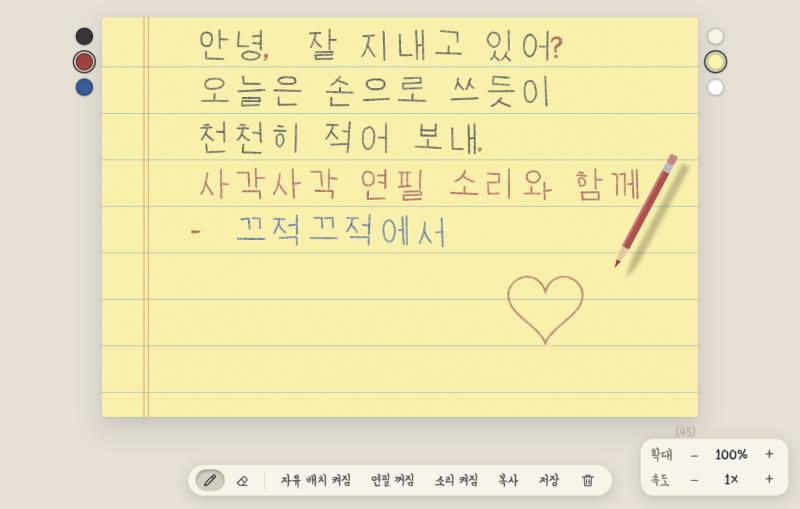
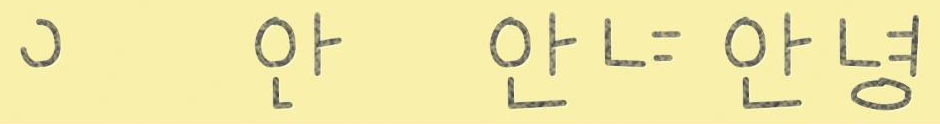
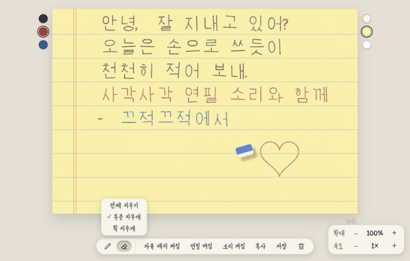
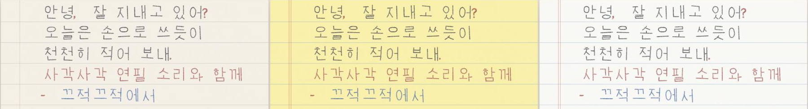
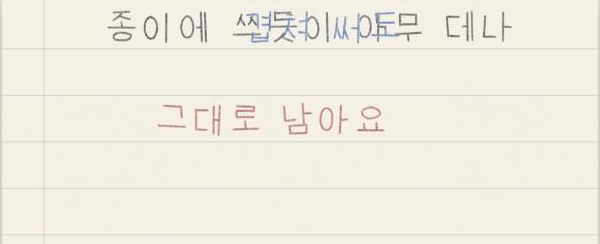
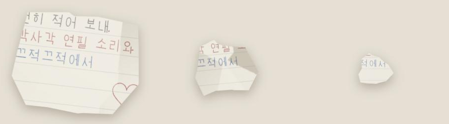

# KJKJ

**끄적끄적** — 바이브 코딩으로 만들어본 손편지 감성을 타이핑으로 느낄 수 있게 옮긴 웹 메모장. 키보드로 치면 연필이 획순대로 글씨를 써 주고, 종이에 끄적이듯 아무 곳에나 쓰고 그릴 수 있음

## 특징

- **획순대로 써지는 글씨**: 타이핑한 한글이 자음·모음 획순을 따라 연필로 써짐. 연필 끝이 닿은 자리에서 글씨가 나타남
- **소리**: 연필, 지우개, 종이 구기는 소리를 코드로 합성함. 음원 파일 없음
- **자유 배치 / 메모 모드**: 종이처럼 아무 곳에나 쓰고 글자끼리 겹쳐 쓰기 가능. 끄면 일반 메모장처럼 이어서 씀
- **그림 레이어**: 글자와 별개의 레이어에 연필로 그리고, 지우개(전체 / 부분 / 획)로 지움. 실행 취소 가능
- **펜 색 / 종이 색**: 펜은 검정, 빨강, 파랑. 종이는 아이보리, 노랑, 하양(리갈패드)
- **저장 / 복사**: 종이를 PNG로 저장하거나 이미지, 글로 복사 가능
- **종이 버리기**: 휴지통을 누르면 종이가 구겨져서 버려짐

## 미리보기

### 획순
`안녕`이 써지는 과정

### 그림 도구
연필, 지우개 아이콘으로 그림 모드를 켬. 지우개는 전체 지우기, 부분 지우개, 획 지우개 중에서 선택

### 종이 3종
왼쪽부터 아이보리, 노랑, 하양

### 겹쳐 쓰기
자유 배치에서는 글자가 밀리지 않고 쓴 자리에 그대로 남음

### 종이 버리기
구겨지는 단계

### 초기 화면

## 사용법

### 글쓰기

| 모드 | 동작 |
|---|---|
| 자유 배치 켜짐 | 종이의 아무 곳이나 눌러 그 자리에서 씀. 글자는 밀리지 않고 겹침 |
| 자유 배치 꺼짐 | 일반 메모장처럼 이어서 씀. 글자 수는 `(공백 제외 / 공백 포함)`으로 표시 |
| 연필 켜짐 / 꺼짐 | 글씨가 써지는 애니메이션과 소리를 켜고 끔. 끄면 글씨가 바로 나타나고 커서가 깜빡임 |

### 단축키

| 키 | 동작 |
|---|---|
| `Enter` | 다음 줄 처음으로 이동 (자유 배치) |
| `Backspace` / `Delete` | 캐럿 왼쪽 / 오른쪽 좌표의 글자를 겹친 것까지 지움 (자유 배치) |
| `←` `→` `↑` `↓` | 캐럿 이동 |
| `Ctrl/⌘ + ←` `→` | 줄의 처음 / 끝으로 이동. `Shift`를 같이 누르면 선택 |
| `Alt/⌥ + ←` `→` | 글자 덩어리 단위로 이동 |
| `Ctrl/⌘ + A` | 전체 선택 |
| `Ctrl/⌘ + Z` | 그림 실행 취소 |
| `Ctrl/⌘ + Shift + Z`, `Ctrl + Y` | 그림 다시 실행 |
| `Esc` | 그림 도구 끄기 |

### 화면 구성

- **왼쪽 동그라미**: 펜 색
- **오른쪽 동그라미**: 종이 색
- **하단 바**: 연필 / 지우개, 자유 배치, 연필 켜짐, 소리, 복사(글 / 이미지), 저장(PNG), 휴지통
- **오른쪽 아래 패널**: 확대(50~180%), 속도(0.5~3배)

## 실행 방법

서버나 빌드 없이 `index.html`을 브라우저로 열면 됨. 작성한 글과 그림은 브라우저 로컬 저장소에만 저장되고 서버로 전송되지 않음

## 알려진 한계

- 모바일 화면은 점검 안 함
- 한글 입력기로 조합하는 도중의 일부 동작(클릭, 방향키)은 실제 키보드 환경에서 추가 점검 필요
- 드래그 선택은 자유 배치 꺼짐(메모) 모드에서만 가능
- 자유 배치에서 확대하면 오른쪽 끝의 글자가 종이 밖으로 보일 수 있음

## 기술

- HTML, CSS, JavaScript 단일 파일. 외부 라이브러리 없음
- 글씨, 그림: SVG / 종이 질감, 저장: Canvas / 소리: Web Audio API
- **한글은 폰트가 아니라 직접 만든 획 데이터로 그림** (자음, 모음 중심선을 SVG 경로로 작성하고 획순대로 조합)
- 글꼴은 영문, 숫자, 기호에만 사용: [Yeon Sung](https://fonts.google.com/specimen/Yeon+Sung) (Google Fonts, SIL Open Font License). 화면 UI 글자에도 같은 글꼴 사용
- 이모지는 시스템 컬러 이모지 글꼴 사용

## 제작

- **AI**: Claude(Anthropic)와 바이브 코딩으로 제작
- **10월 14일**: 아이디어 구체화
- **10월 15일**: 약 10시간 동안 제작
